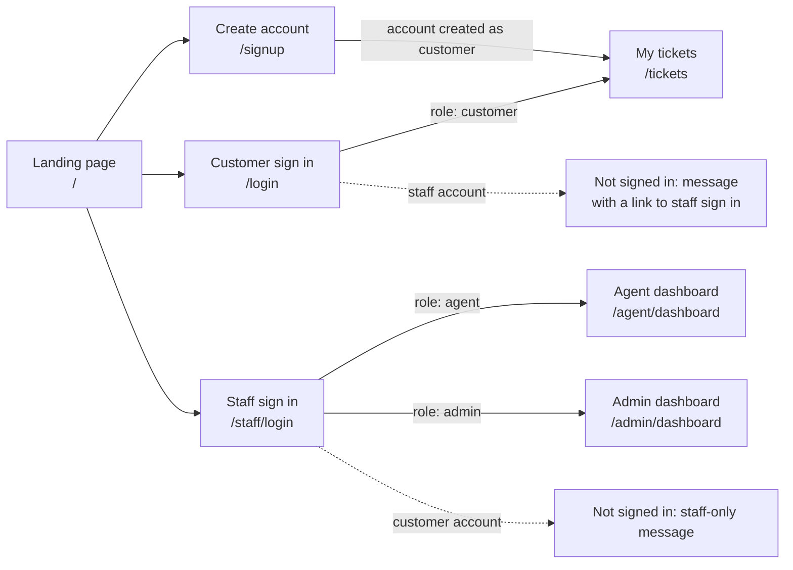
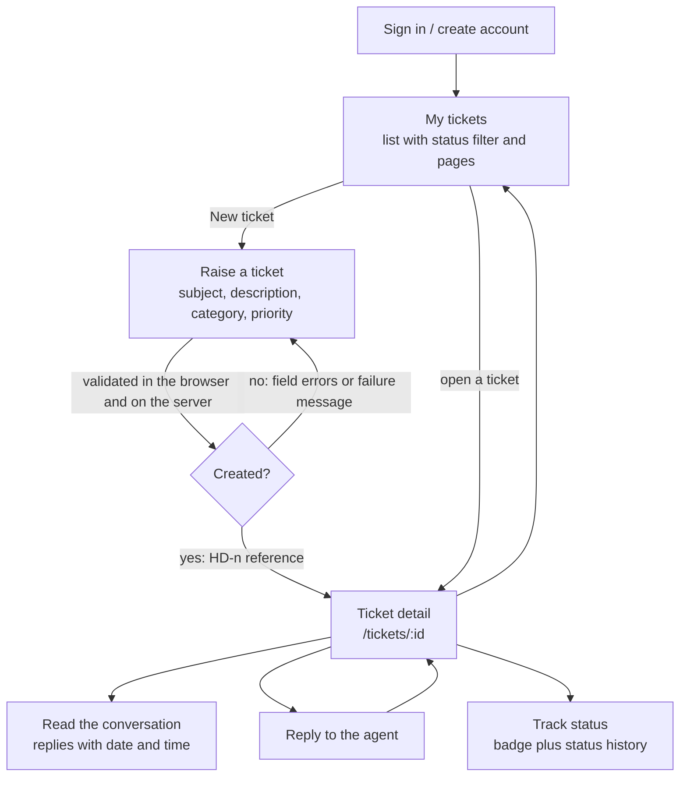
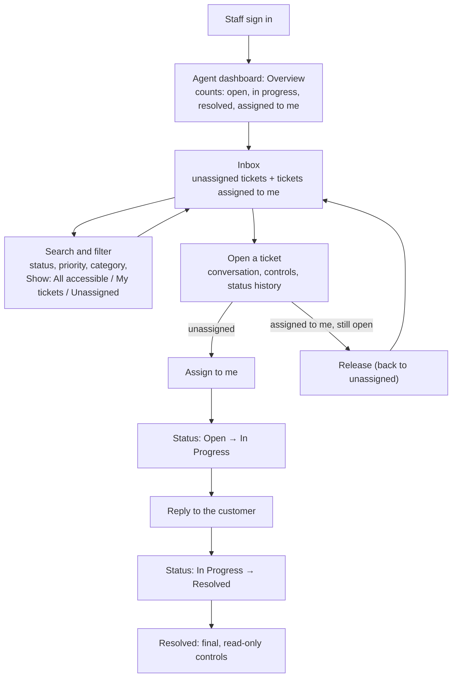
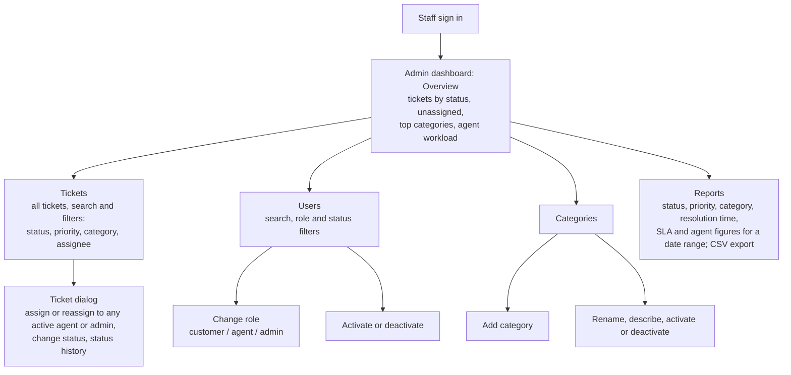
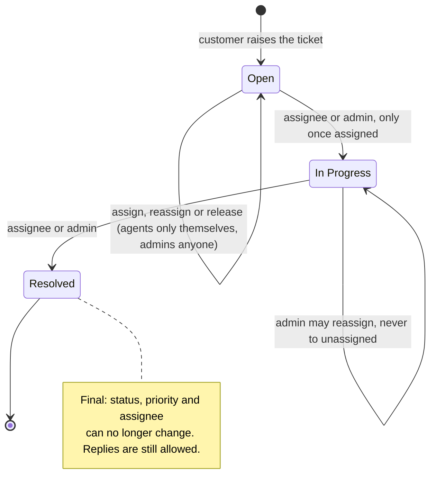
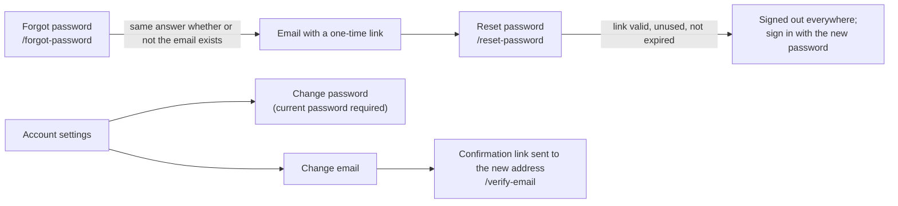

# Help Desk — User Flows

How customers, agents and administrators move through the application, as implemented (October 2026). Screens are named as they appear in the app; routes are in `code`. The rules behind each step are in [API_CONTRACT.md](API_CONTRACT.md) (decision numbers such as D-10 refer to it).

GitHub renders the diagrams below. In other viewers, paste a block into <https://mermaid.live>.

## Contents

1. [Entry points and roles](#1-entry-points-and-roles)
2. [Customer](#2-customer)
3. [Agent](#3-agent)
4. [Administrator](#4-administrator)
5. [Ticket lifecycle and who may change it](#5-ticket-lifecycle-and-who-may-change-it)
6. [Account recovery and security](#6-account-recovery-and-security)

---

## 1. Entry points and roles

Customers sign up themselves. Agents and administrators are staff accounts: the first admin is created with `npm run create:staff`, and admins then change roles in the dashboard. Every signed-in page checks the role on the server as well as in the browser.

Signed-in users also have a **notification bell** in every header (new ticket, assignment, status change, reply), and **account settings**: `/profile` for customers, `/staff/account` for staff.

## 2. Customer

- A customer sees **only their own tickets**; another customer's ticket link gives "not found".
- A repeated submission (double click, retry after a network error) returns the ticket already created instead of a second one (contract §7, `Idempotency-Key`).
- Replies are allowed on open, in-progress and resolved tickets (D-3).
- When staff move a ticket to In Progress or Resolved, its customer gets one email (contract §8). Customers see no SLA information.
- If no category is active, New Ticket explains that tickets can't be raised right now and disables the form; an admin fixes this under Categories. If a category is deactivated while the form is open, submitting asks the customer to choose another, keeping what they wrote.

## 3. Agent

- An agent never sees tickets assigned to **another** agent (OPEN-1), whatever filter is chosen.
- An agent changes status and replies **only on tickets assigned to them** (D-10, D-11); the screen explains why a control is locked.
- An in-progress ticket cannot be released, only resolved (or reassigned by an admin).
- Each ticket in the Inbox and in Admin Tickets shows an SLA badge: Due, Due soon, Overdue, Met, Missed or No SLA. Ticket details also show the exact due date. A priority change moves the due date; assignment and status changes do not.

## 4. Administrator

- Admins cannot change their own role or deactivate themselves, and the **last active admin** cannot be demoted or deactivated.
- Category names are unique ignoring letter case. A deactivated category stays on its existing tickets but cannot be chosen for new ones; the backend also refuses it if sent directly.
- Reports covers tickets **created** in the selected range (last 7, 30 or 90 days, all time, or custom dates in the browser's time zone). Resolved outcomes (Met, Missed) are kept apart from current risk (Due, Due soon, Overdue), and the CSV export follows the same range.

## 5. Ticket lifecycle and who may change it

| Status | Has an assignee | Who can move it forward | Recorded |
| --- | --- | --- | --- |
| Open | optional | the assignee, or an admin, once it is assigned | first history entry, by the customer |
| In Progress | always | the assignee or an admin | history entry with who and when |
| Resolved | always | nobody (final) | history entry and `resolvedAt` |

Skipping a step, going backwards or repeating a status is refused (`400 INVALID_STATUS_TRANSITION`); changing an unassigned or resolved ticket is refused with a clear message (`ASSIGNEE_REQUIRED`, `TICKET_RESOLVED`).

## 6. Account recovery and security

Emails need a working email transport: in development they are written to `backend/.outbox/`; in production SMTP must be configured (see README, "Email").
